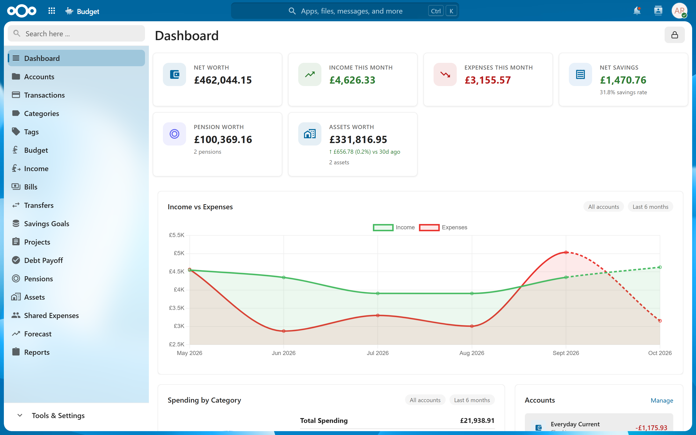

# Nextcloud Budget

Budget is a personal finance app for Nextcloud. It keeps your bank accounts, credit cards, loans and pensions in one place, imports the statements your bank gives you, tracks spending against a budget and forecasts where your balances are heading, with all of the data staying on your own server.

## What it does

- Accounts and transactions in over 45 currencies, with splits, tags, transfers and statement reconciliation
- Statement import from CSV, Excel and LibreOffice spreadsheets, OFX, QIF and camt.053 XML, exports from Firefly III, YNAB, Actual Budget, Mint and Monarch Money, and an import folder that imports the statements you drop into your Files
- Rules that categorise transactions for you, and bank sync through GoCardless, SimpleFIN or Enable Banking (in beta)
- Receipt photos attached to transactions, and receipt scanning (OCR) that reads the amount and items once an admin sets it up
- Category budgets (including envelope budgets that roll over) with a "ready to assign" figure, project budgets for jobs that run over months, bills, recurring income and balance forecasts
- Detection of payments that look recurring but are not tracked yet, so subscriptions become bills in one click
- Savings goals, debt payoff plans, assets, pensions and net worth history
- Reports with PDF export, including a money flow (Sankey) diagram, scheduled monthly PDF reports, and a dashboard you can arrange yourself
- A weekly or monthly digest and alerts for unusual spending
- Sharing accounts and budgets with other Nextcloud users, and splitting expenses with one or several people
- Nextcloud dashboard widgets, unified search and a calendar feed for your bills
- [Budget Companion](https://play.google.com/store/apps/details?id=dev.otherworld.budget), the Android app on Google Play, for photographing receipts and checking your balances, budget and bills from your phone
- A Quick Add page for recording spending from any phone browser, and a [public API](https://budget.otherworld.dev/docs/api.html) for scripts and automation
- A getting started checklist for new users, with sample data to try the app before adding your own

Every feature is explained in the [documentation](https://budget.otherworld.dev/docs/), and the [changelog](budget/CHANGELOG.md) lists what has changed in each release.

## Installation

Budget needs Nextcloud 30 to 35 and PHP 8.1 or later with the BCMath extension, and works with MySQL/MariaDB, PostgreSQL or SQLite.

The simplest way to install it is from the Nextcloud App Store: log in as an admin, go to **Apps**, search for "Budget" and click **Download and enable**. To install from a release tarball or from source instead, see [INSTALL.md](INSTALL.md).

Once it is enabled, the [getting started guide](https://budget.otherworld.dev/docs/getting-started.html) takes you through adding your first account and importing a statement.

## Bank sync with Enable Banking

[Enable Banking](https://enablebanking.com) is a licensed EU account-information provider. Its free "restricted production" mode only works for the accounts of the person who owns the Enable Banking application, so each Nextcloud user sets up their own application. Full production access needs a contract with Enable Banking.

Before you start, a Nextcloud admin has to switch on **Enable Bank Sync** in Budget's admin settings. Bank sync stays hidden until then.

1. In the Enable Banking control panel, create an application.
2. Generate an RSA key pair and a self-signed certificate, for example `openssl req -x509 -newkey rsa:4096 -nodes -keyout private.pem -out public.crt -days 730 -subj "/CN=budget"`, and upload the certificate (`public.crt`) to the application.
3. Whitelist the callback URL that Budget's wizard shows, which ends in `/apps/budget/bank-sync/enablebanking/callback`. In production it must use `https`.
4. In the control panel, link every bank account you want in Budget. A restricted production application only becomes active once at least one account is linked, and Budget can only see accounts that are linked there.
5. In Budget, go to **Bank Sync**, click **Add Connection**, choose **Enable Banking (Europe)** and enter the application ID and the contents of `private.pem`. You only do this once: they are stored encrypted for your user and reused for every bank.
6. Pick a country and a bank, confirm in the bank's app, come back and click **I've Completed Authorization**, then map the accounts and sync. If the bank shares no account, Budget marks the connection as needing re-authorization: link the account in the control panel, then click **Re-authorize**.

Consent lasts up to 180 days, or the bank's maximum if that is shorter. After that, use **Re-authorize**, and link any new accounts in the control panel first (for example 180 days for comdirect, 90 days for Trade Republic). Trade Republic delivers only amount, currency and booking date per transaction, with no description or counterparty, so rules that match on text won't apply to it. PSD2 covers payment accounts only, so securities and depot accounts are not available, and banks allow only a few automatic refreshes per day.

The first time an account syncs into an empty Budget account, Budget sets that account's opening balance so that its balance matches the bank's. This happens automatically for Enable Banking only; with the other providers, Budget shows the difference and a **Reconcile** button instead. If the balances differ later, Budget shows the difference with a **Reconcile** button and never corrects it silently.

The Nextcloud server only contacts `api.enablebanking.com`. Budget shows bank names only; it loads no bank logos.

## Translations

Translations are managed on [Weblate](https://hosted.weblate.org/projects/nextcloud-budget/), where you can translate in the browser without touching any code and your work is merged into the app automatically. Strings containing `{placeholders}` (e.g. `{amount}`) must keep the placeholder names exactly as they are. If you would rather work with `.po` files, see the [translation guide](budget/translationfiles/README.md).

## Contributing

Bug reports and feature requests go in [GitHub Issues](https://github.com/otherworld-dev/Budget/issues), and questions in [Discussions](https://github.com/otherworld-dev/Budget/discussions). For code changes, fork the repository, work on a branch from `dev`, and run `make test` and `make lint` in `budget/` before opening a pull request. [INSTALL.md](INSTALL.md#development-setup) covers setting up a development copy.

## Support the project

Budget is free and open source, and built and maintained in spare time. If it is useful to you, especially if it replaced a paid finance service, you can support development through [GitHub Sponsors](https://github.com/sponsors/otherworld-dev) (monthly or one-time) or [PayPal](https://www.paypal.com/donate/?hosted_button_id=MA56N6K8FSTQ2).

## Acknowledgements

This app is shaped by the people who report bugs, suggest features and translate it:

- **[@SGiersch](https://github.com/SGiersch)**: dozens of bug reports, feature discussions, and the German translation
- **[@TerjeTM](https://github.com/TerjeTM)**: thorough testing and detailed bug reports that led to major improvements in the bills system and data repair tools
- **[@JaviAZ](https://github.com/JaviAZ)**: code contributions and bug reports around category spending and transfers
- **[@jumaxotl](https://github.com/jumaxotl)**: the complete French translation
- **[@H2Oufoe](https://github.com/H2Oufoe)**: extensive bug reporting and testing across multiple releases
- **[@st33vil](https://github.com/st33vil)**: found the pagination balance calculation bug
- **[@T0mFi](https://github.com/T0mFi)** and **Pavel Borecki**: the Czech translation
- **[@raduberbece](https://github.com/raduberbece)**, **[@MrTCAJ](https://github.com/MrTCAJ)** and **[@mschur](https://github.com/mschur)**: bug reports and feedback

## Licence

Budget is licensed under the **AGPL-3.0-or-later** licence.
